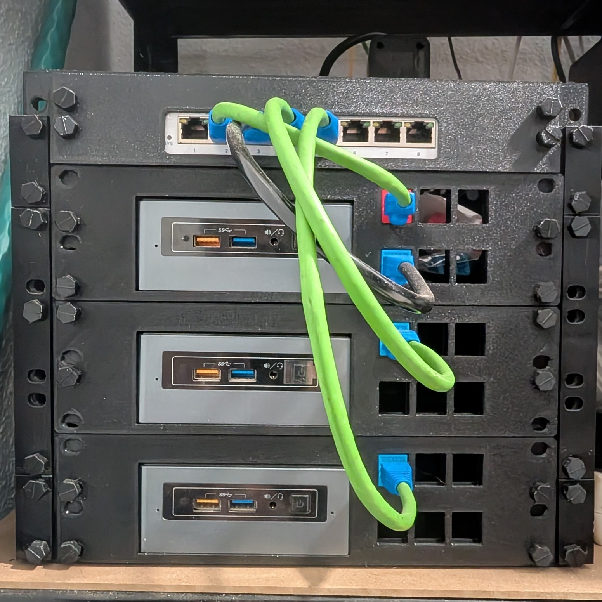

# Clúster 01 - El germen

> Clúster 01 - Nucster

- [Inicio](../../../index.html)
- [Proyectos](../../../proyectos.html)
- [Clúster 01 - El germen](cluster01elgermen.html)

## Estado inicial

Este blog nace con un objetivo sencillo: documentar, paso a paso y sin maquillar los errores, cómo se construye un pequeño laboratorio de sistemas desde cero. Estoy aprendiendo, así que lo que lees aquí no es una guía de expertos, sino un cuaderno de bitácora.

## La idea

La base será un clúster Proxmox. Sobre él, y dentro de máquinas virtuales, montaré un clúster de Kubernetes. Quiero entender cada capa por separado antes de juntarlas: virtualización, redes, almacenamiento y, por último, orquestación de contenedores.

Este laboratorio es independiente de mi homelab de uso diario (producción), al que prefiero llamar homeserver porque no experimento en él. Aquí se puede romper todo, y de eso se trata.

## Hardware

El hardware:

- 3 mini PC Intel NUC6CAYH
- CPU: [COMPLETAR]
- RAM por nodo: [COMPLETAR]
- Almacenamiento por nodo: [COMPLETAR]
- Una sola tarjeta de red por equipo, excepto en el equipo que tendrá instalado PfSense como router y firewall que tendrá un NIC usb-ethernet adicional.
- Switch gestionable Zyxel GS1200-8:
  - Soporta VLAN 802.1Q.
  - Se configura solo por web, sin línea de comandos ni agregación de enlaces (LACP).

*Estado inicial del hardware del clúster llamado Nucster.*

## Arquitectura

Lo que aún no está decidido estoy en la fase de planificar, y mucho queda aún por decidir:

- Cómo repartir los tres nodos: todos en el clúster Proxmox, o reservar uno para copias de seguridad con Proxmox Backup Server.
- La topología de Kubernetes: cuántos nodos de control y cuántos de trabajo, clusterizar y todo lo que requiere y conlleva es completamente nuevo para mí.
- Cómo garantizar servicios como el DNS (Pi-hole) si cae un nodo.

## Sobre la documentación

Iré anotando cada decisión con su razonamiento, y también cuando me equivoque y tenga que rectificar en dos formatos distendidos: el blog y un informe técnico. El blog será más informal, con capturas de pantalla y gráficos de consumo de recursos, mientras que el informe técnico será más formal, con diagramas de red y tablas de configuración.

*Todos los datos capturas serán tratados antes de ser publicados para no comprometer la seguridad de mi homelab, de mi red, o de mi privacidad.*

## Proyectos

- [Proyectos](../../../proyectos.html#proyectoscatalogo):

---

Christian Comes - octubre de 2026
