# El día que entendí que "instalar pfSense" empieza con fingir que tienes WAN: Clúster 03

> Segunda fase de Nucster: pfSense master en la VM 100 del 30. Spoiler apetitoso: el instalador es online (gracias, Netgate), mi cableado real era el contrario del plan y el error más feo no fue de software sino de capa 1. Como manda la regla de la casa, aquí van dudas, porqués, cagadas y cómo salí.

## 0. De dónde parto (y qué toca hoy)

Con el clúster [formado y sano 3/3](cluster02primerospasos.html), llega lo que lo empezó todo: pfSense de verdad. La receta que me dejé escrita: VM 100 `pfsense-master`, 2 GiB RAM, 2 núcleos *host*, disco de 32 GB en `local-lvm`, dos NIC VirtIO (net0 → `vmbr1` WAN, net1 → `vmbr10` LAN aislada), `vmbr1` con el USB de puerto y el mismo montaje en el 20 con su propio USB (ambos `enx…`, nombres derivados de la MAC, truncados) para el CARP futuro. Regla nueva de la casa: todo por GUI cuando se pueda; consola solo para mirar.

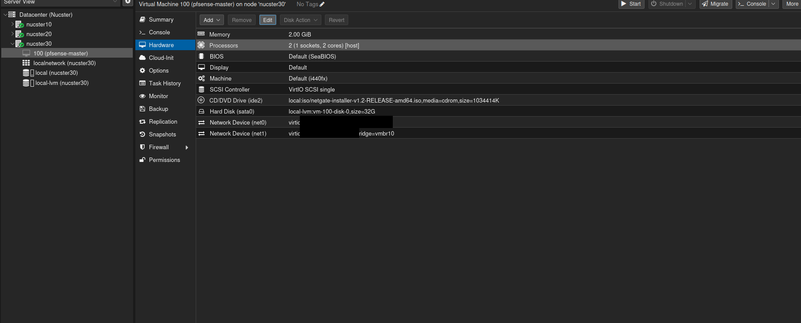

*Las dos redes separadas desde el diseño: WAN en vmbr1, LAN en vmbr10.*

## 1. La trampa del instalador online

Copié por `scp` la ISO (1 GB, `netgate-installer-v1.2-RELEASE-amd64.iso`) a los tres nodos creyendo que era la ISO offline de pfSense CE. No: es el **Netgate Installer**, que instala Plus por defecto y **necesita internet** durante la instalación. La gracia es elegir **Install CE** en el aviso de dispositivo no soportado; y el espejo comunitario atxfiles solo llega hasta 2.7.2, así que la descarga va contra los servidores de Netgate. Moral: la WAN tiene que funcionar ANTES de instalar.

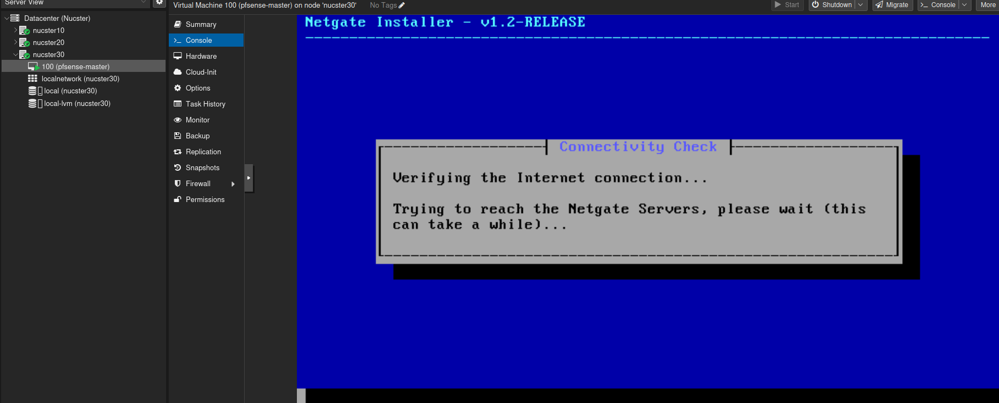

## 2. WAN y LAN en el instalador

Pantallas: WAN en `vtnet0` modo DHCP sin VLANs; LAN en `vtnet1` estática 192.168.10.1/24 con su DHCP de .100 a .199; ZFS + GPT por defecto; y en la selección de versión tomé la 2.9.0 (current stable). Descarga real: **179 paquetes, 994 MiB necesarios, 298 MiB bajados**. Al terminar, reboot… y no me olvidé de soltar el CD de la VM (edit del CD/DVD a "Do not use any media") para que el instalador no reaparezca en cada arranque.

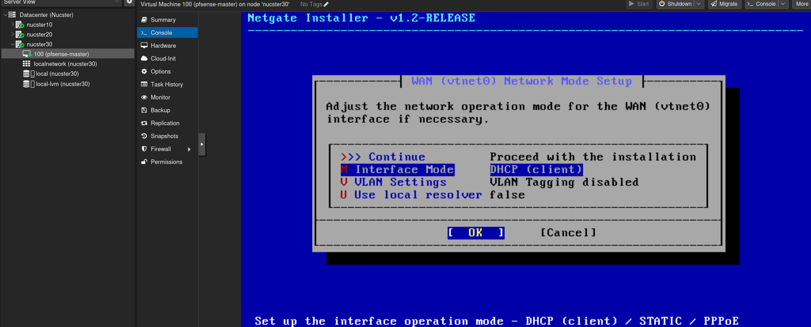
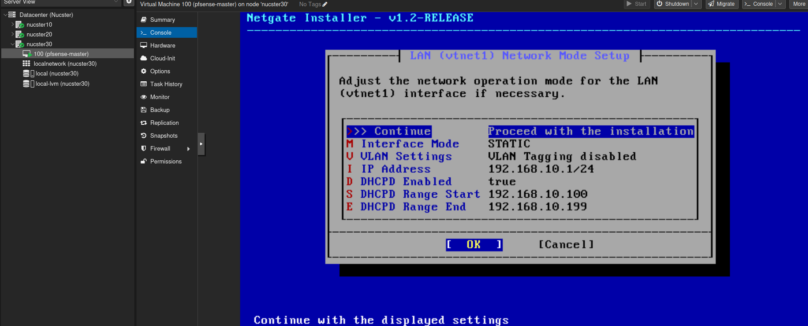
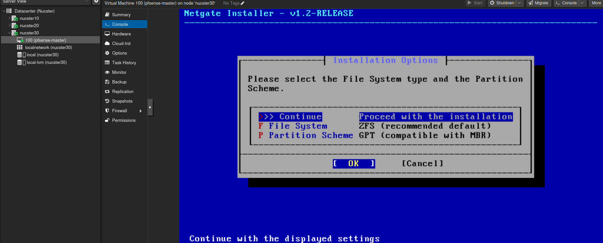
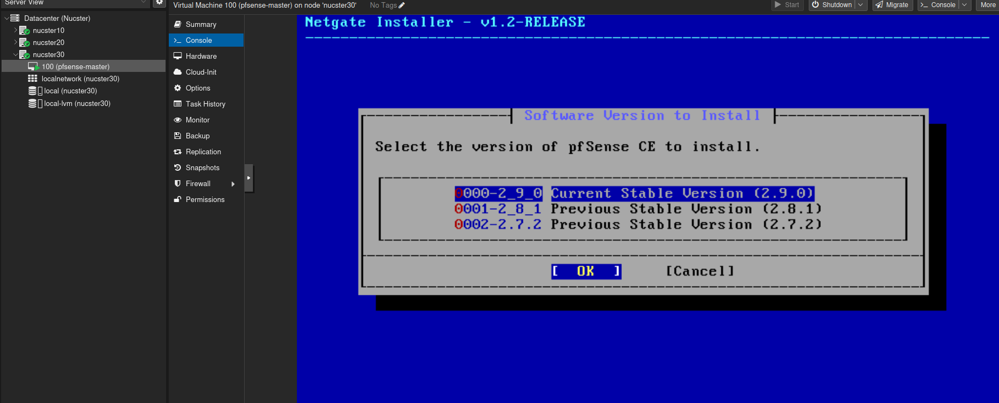
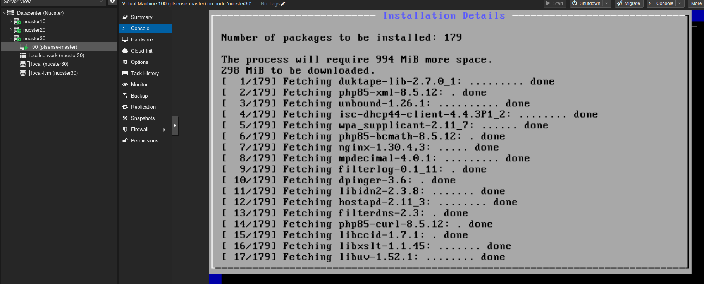
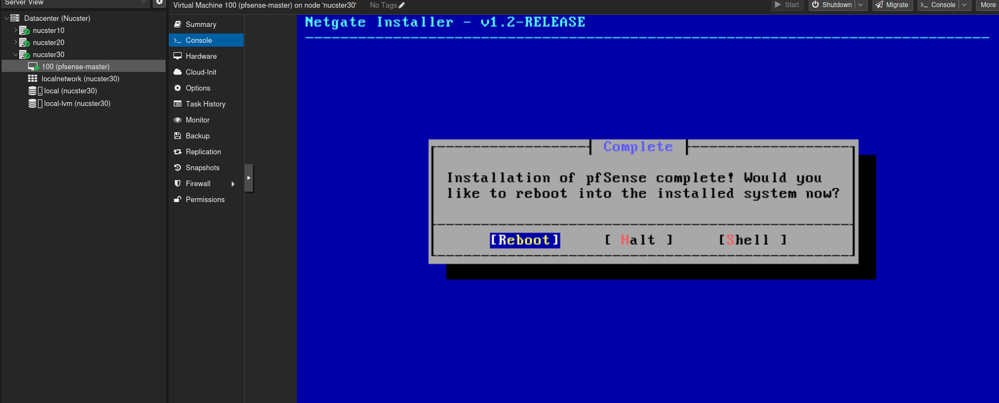
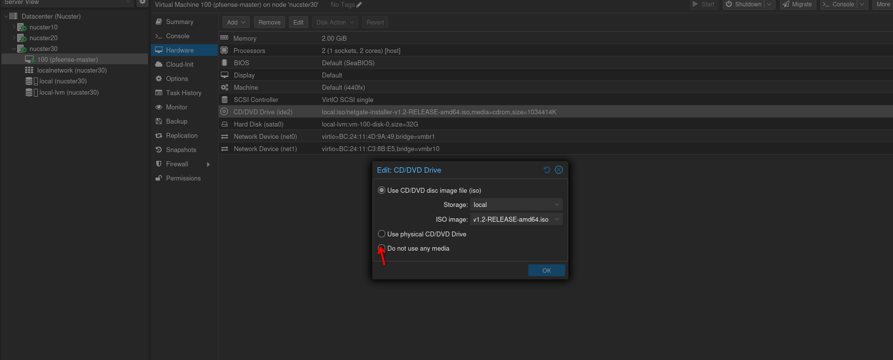

## 3. Primer arranque

Menú de consola clásico: `WAN -> vtnet0 -> v4/DHCP4: 192.168.1.52/24` (concesión del Movistar) y `LAN -> vtnet1 -> v4: 192.168.10.1/24`. Todo lo configuro desde la VM 102 (Debian live en la LAN aislada, jumpbox): acepto el certificado autofirmado de Firefox (esperado, nadie avala el cert de pfSense; solo aceptable en una LAN propia), entro con `admin`/`pfsense` de fábrica y el WARNING rojo te grita que lo cambies YA (apartado 4).

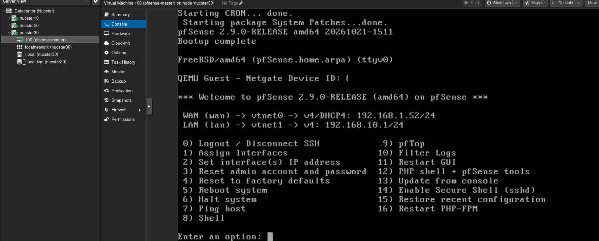
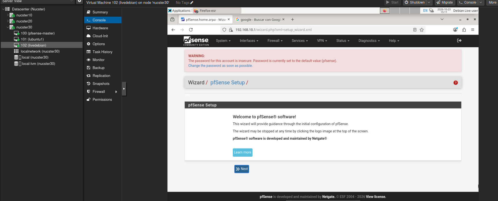
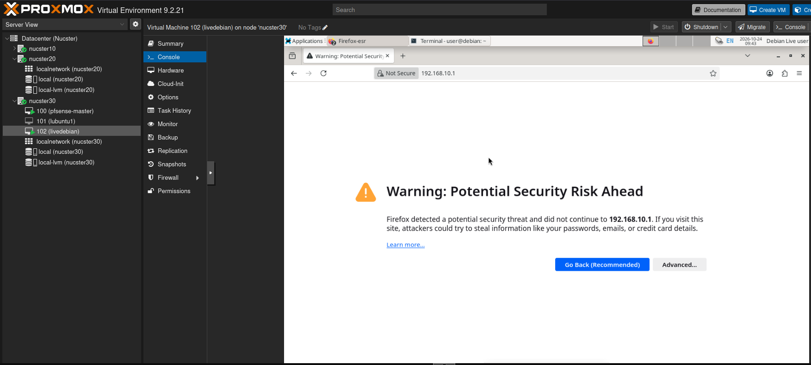
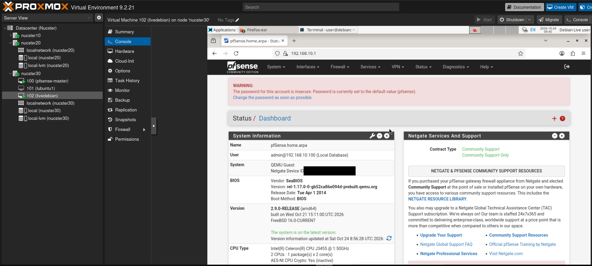

## 4. El wizard, casilla a casilla con su porqué

- **General:** hostname `pfsense-master`, dominio `home.arpa` (no `.local`, que es de mDNS: RFC 8375 manda), DNS `1.1.1.1` + `80.58.61.250` (los mismos de los nodos) con Override. Matiz del wizard: el DNS Resolver solo usa esos DNS para clientes si activo DNS Query Forwarding — decide después.
- **NTP/zona:** por defecto + `Europe/Madrid`. El reloj desajustado mata certs y VPN.
- **WAN:** DHCP y **desmarco Block RFC1918** (doble NAT del lab; con WAN real, marcada sí o sí). Bogons se queda.
- **LAN:** no se toca, 192.168.10.1/24.
- **Admin:** cambio la contraseña y me aseguro que la deja fuera del blog, obvio.
- **Reload:** pasos 7-9. Y NO toco "Check for updates": para CARP el backup debe llevar LA MISMA versión exacta.

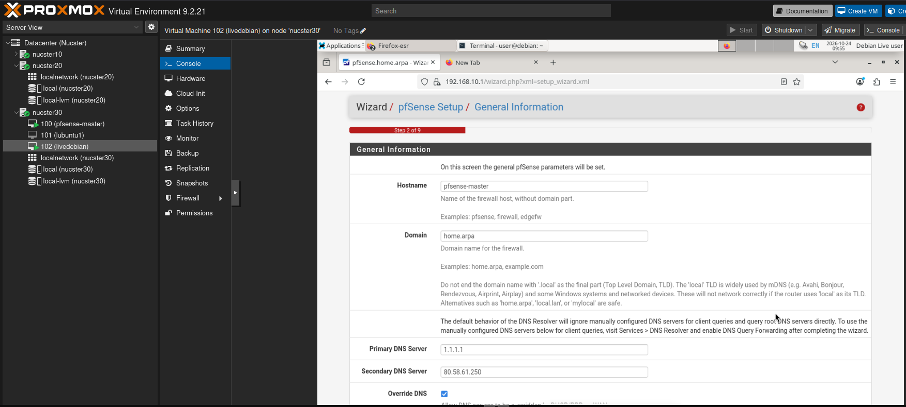
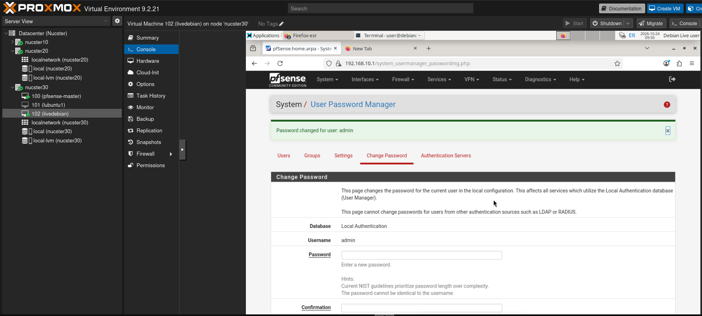
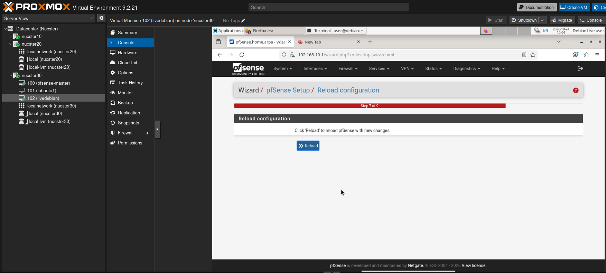

## 5. Validación con la 102

La 102 recibió por DHCP del pfSense `192.168.10.100/24` con gateway `192.168.10.1` (probar: `ip -br a`, `ip route`), y los tres pings: a `192.168.10.1` (LAN), a `1.1.1.1` (NAT, ~10-15 ms) y a `deb.debian.org` (DNS + salida, ~12 ms). El "Name or service not known" del ping por nombre a la LAN me lo explico yo solo: la LAN aislada no registra nombres.

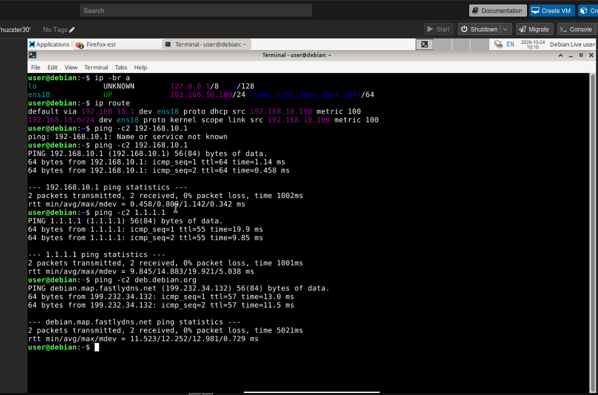

## 6. Lo que se rompió: la configuración era correcta, el cable no

- **El USB en DOWN y el comando sin verbo.** Tres veces lancé `ip link set dev enx...` y no hacía nada: faltó `up`. Con él: UP y el PHY negocia (LOWER_UP + `ethtool` "Link detected: yes"). DOWN es estado administrativo; LOWER_UP es el del cable. No hay pureza semántica que valga.
- **El bridge sin puertos** (vmbr1 del 20 con Ports/Slaves vacío = switch virtual sin cables). Fix: asigno el USB como puerto y Apply. Buen detalle de Proxmox: escribe en `interfaces.new` y no toca la red viva hasta el Apply.
- **Las dos islas.** Quitar el cable switch↔router: clúster 3/3 (los nodos se hablan por el switch), pero el PC sin gateway/sin internet/sin Tailscale 10/20. Reconectar y a otra cosa.
- **El cableado real del 30 al revés respecto a mi plan** (onboard → router directo, USB → switch) — y la hipótesis de ARP flux — **refutada con medición**: `ip neigh flush` + `ip neigh show` y `arping -I vmbr0 -c3 192.168.1.30` (instalé `arping` con permiso): 3 respuestas, una sola MAC (`1c:69:7a:xx:xx:xx`). La causa era física: antes de teorizar, pregunta por el enchufe y el keystone.
- **El `qm set` erróneo:** `qm set 100 --net1 vitrio=...,tag10` → `400 Parameter verification failed`. Doble typo (`vitrio`, `tag10` sin `=`) y una tercera lección: `qm set --net1` REEMPLAZA la definición de net1 al completo. Sin cambios aplicados (la verificación choca antes de escribir).
- **El bridge dentro del bridge:** `puepfsense` (puerto = otro bridge) no es válido; y en la VLAN `vmbr0.10` con gateway dio `400 gateway: Default gateway already exists on interface 'vmbr0'` — solo puede haber un default gateway; cualquier otra IP va sin gateway. Y ojo seguridad: darle IP al host en la LAN de pfSense expone GUI/SSH de Proxmox al lab sin pasar por el firewall (sigo administrando pfSense desde la 102).
- **Colateral:** Tailscale en el 30 tomó el `/etc/resolv.conf` del nodo y el CT 200 lo heredó al arrancar (`fd7a:...::53` dentro del CT sin `tailscale0` = "network is unreachable" en Docker). CT pendiente de reinicio (y cuando Pi-hole esté arriba, que Pi-hole no sea su propio DNS). 10/20 offline en Tailscale ~1h por revisar.

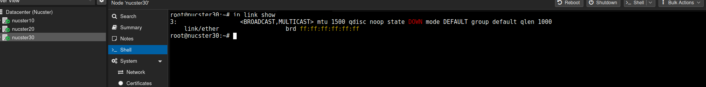
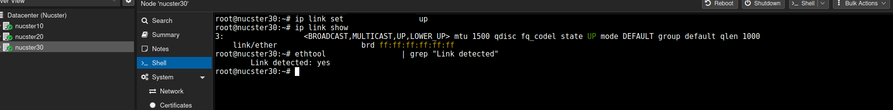
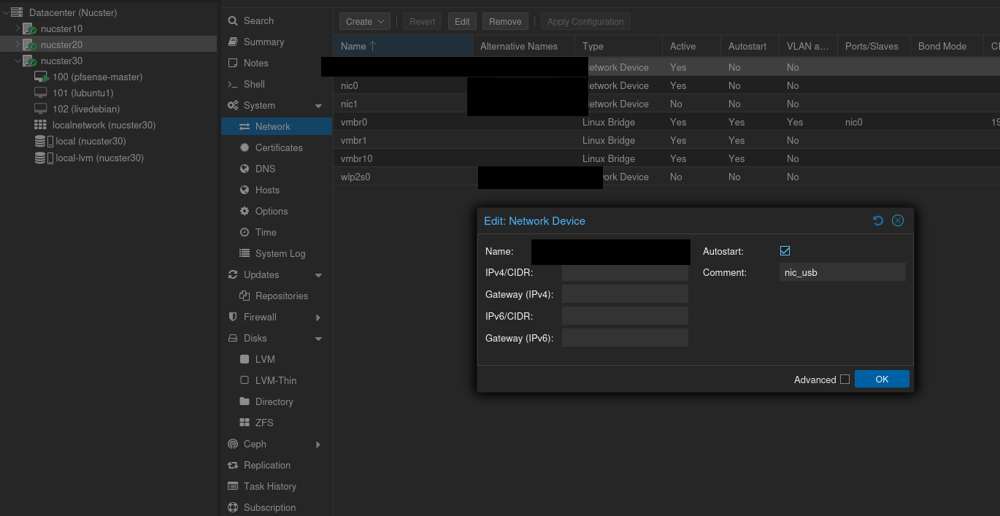
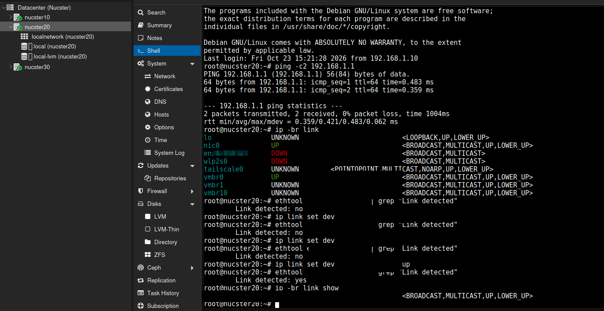

## 7. Cierre con red de seguridad

1. **Snapshot** de la VM 100 con RAM (`pfsense-master-freshinstall-validado`, 1.90 GiB en 17 s).
2. **Export del config.xml** (Backup area All, RRD fuera, SSH keys sí): 12,1 KB, de la 102 vía `scp` a `/root/scp-recibido/pfsense-conf-bk/` del 30. *Faena pendiente*: regenerarlo cifrado y guardar la contraseña en gestor (un XML en claro lleva las credenciales dentro).

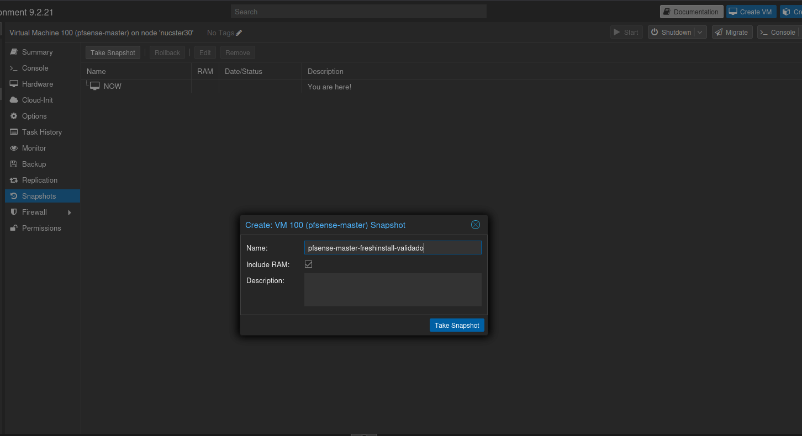
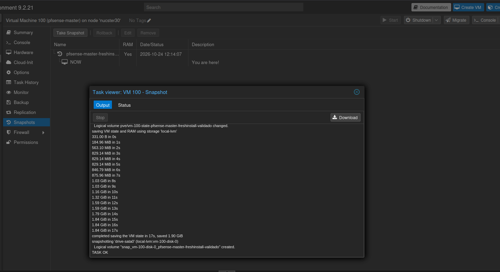
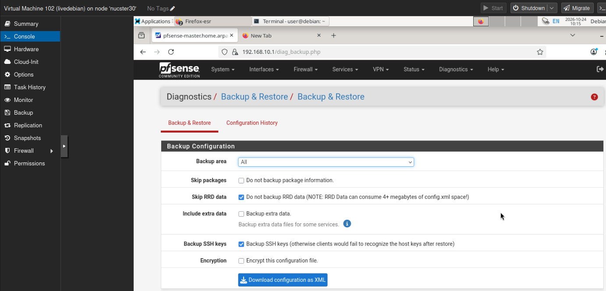

## Cierre: qué me llevo hoy

pfSense CE 2.9.0 master al completo: wizard con su porqué, admin endurecido, DHCP/NAT/DNS validados y backup en dos formatos. Lo que me ensañé bien: el instalador es online (no ISO offline); y el error más feo no fue de software sino de cable — la lección de arping me sirvió para refutar otra hipótesis y acabar cayendo en la capa 1.

Siguiente: alinear cables, VLAN 10 en el Zyxel, mover la LAN de pfSense a `vmbr0` tag 10 (con la 102 detrás) y clonar el camino en el 20 para el `pfsense-backup` con CARP. Y el CT 200 en su VLAN 10 con Docker, que lleva una luna sin arrancar.
